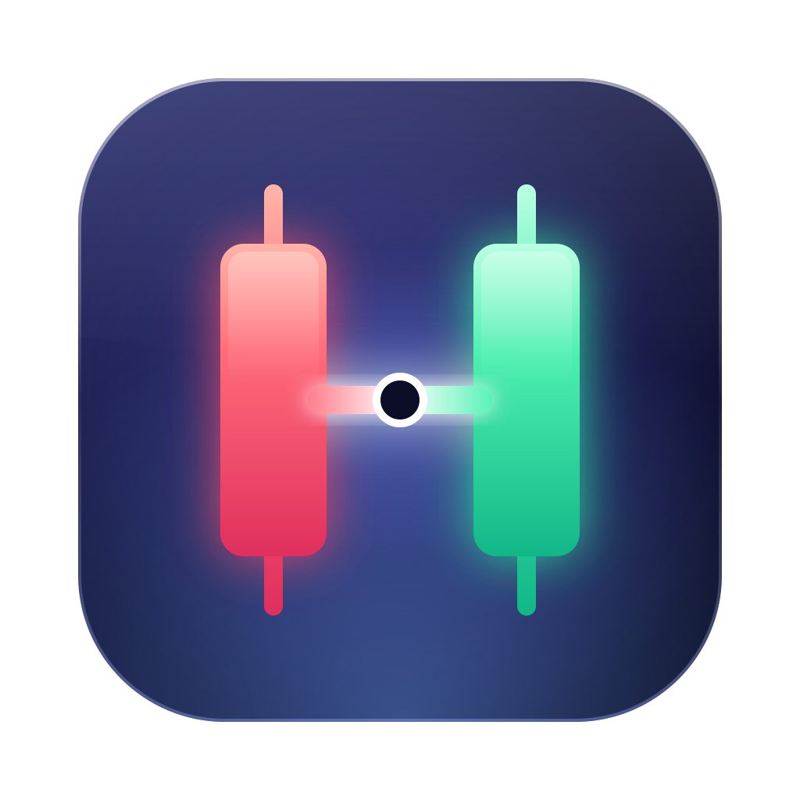
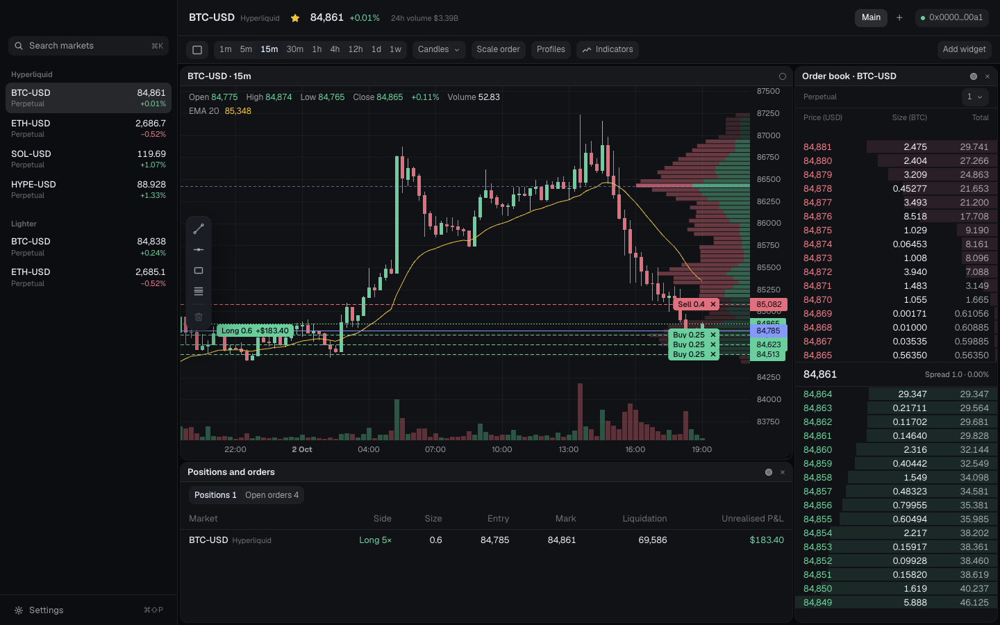
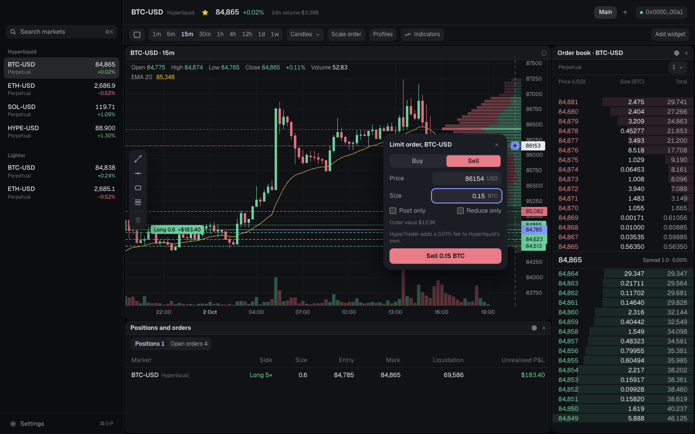
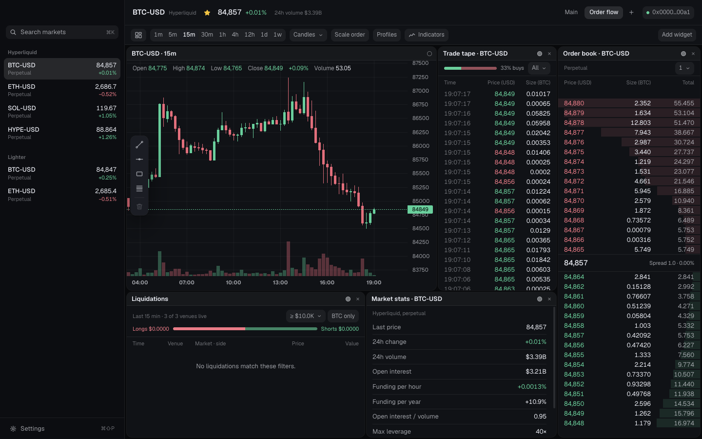

<p align="center"></p>

# HyperTrader

**Trade from the chart.** A desktop charting terminal for [Hyperliquid](https://hyperliquid.xyz) and [Lighter](https://lighter.xyz), with orders you place, drag and scale right on the chart. TPO, volume profile and order flow are built in.

**Public beta · macOS 12 or later · Free**

[**Download for Apple Silicon**](https://github.com/kylebolton/HypertraderPublic/releases/latest/download/HyperTrader-arm64.dmg) · [Download for Intel](https://github.com/kylebolton/HypertraderPublic/releases/latest/download/HyperTrader-x64.dmg) · [Website](https://liquyn.com/hypertrader)



## What it does

- **Orders on the chart.** Press + on the price axis (or click an order book row) for a limit ticket. Drag a line to move the order, click its tag to cancel. Drag a range to place a scale order across it.
- **Two exchanges.** Hyperliquid (perpetuals and spot) and Lighter (perpetuals), side by side, with saved markets and search.
- **Market profile.** TPO with value area, point of control and initial balance, plus a volume profile.
- **Order flow.** Live tape, liquidations from Binance, Bybit and OKX, open interest and funding, an order book, and cumulative volume delta.
- **Workspaces.** Up to 16 charts, books and feeds in a grid, saved per workspace. A command palette on ⌘K, and every shortcut can be changed.
- **20+ indicators and drawing tools.**
- **Nine themes** and an editor for colours, type and corners.




## Your keys

HyperTrader never holds your wallet's keys. Your wallet (a browser wallet such as MetaMask or Rabby, or any WalletConnect phone wallet) signs a few approvals once. The app then trades with a key it creates on your Mac, encrypted with the macOS keychain, that can place and cancel orders but cannot withdraw or transfer funds.

## Fees

The app is free. HyperTrader adds **0.01%** of an order's value on Hyperliquid (a builder fee) and on Lighter (an integrator fee), on top of each exchange's own fees. The order ticket shows it before you place the order.

## Lighter and your location

Lighter does not accept trading from some regions. If an order is refused for that reason, HyperTrader says it is because of your location. Charts and market data still work.

## Verify your download

Every build is signed with a Developer ID certificate and notarized by Apple.

```sh
spctl -a -vvv -t install ~/Downloads/HyperTrader-arm64.dmg
xcrun stapler validate ~/Downloads/HyperTrader-arm64.dmg
shasum -a 256 ~/Downloads/HyperTrader-arm64.dmg   # compare with SHA256SUMS.txt
```

## Status and risk

This is a public beta. Trading has been tested end to end on the exchanges' test networks; start with small sizes. Trading perpetual futures involves risk, including the loss of all funds you put in. HyperTrader is not affiliated with Hyperliquid or Lighter, and nothing here is financial advice.

## Support

[liquyn.com/hypertrader/support](https://liquyn.com/hypertrader/support) · hello@kylebolton.me. Never send a seed phrase or private key to anyone.

The source code is private. This repository holds the README and signed releases.
